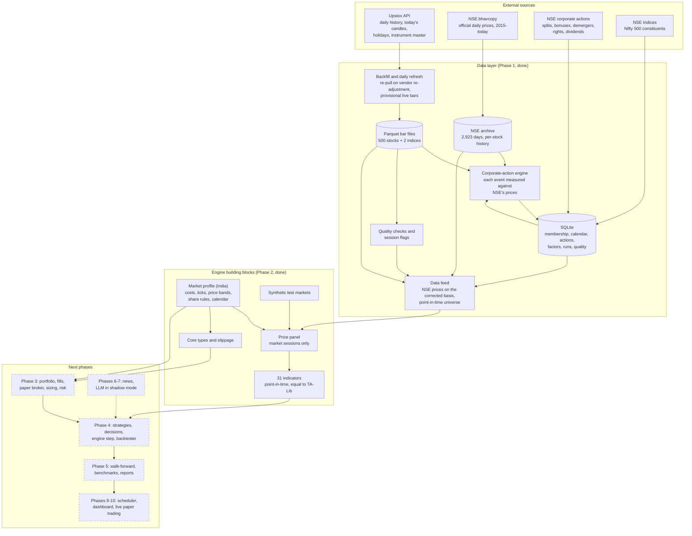

# Audit of Phases 0-2: 2026-10-20

This report covers everything built so far: the data layer (Phase 1) and the building blocks for the trading engine (Phase 2). For each part it says whether it was done correctly, what was wrong and what was fixed. It ends with the architecture and the next steps.

## Verdict

**The data layer and the engine building blocks are correct and ready for Phase 3.** The audit found real problems. Every one that could distort a backtest has been fixed and covered by a test. The few that remain are limits of the available data, and they are listed below.

The largest change came from checking our prices against NSE's own records. All 2,923 daily NSE price files since 2015 were downloaded. The vendor data turned out to be imprecise for about 30 stocks and wrong on a few days.

The system now takes each stock's daily prices from NSE's official files. It keeps the adjustment for splits, bonuses and demergers. Vendor (Upstox) prices only fill days NSE has no file for.

| Check (real data, 500 stocks, 2015-01-01 to 2026-10-19) | Result |
|---|---|
| Data-quality errors in the series strategies read | 0 (the raw vendor files have 5) |
| Stocks whose prices disagree with NSE's files in a way no corporate action explains | 0 of 497 (raw vendor data: 56) |
| Stocks with rounding noise above 0.1% on more than 5% of days | 0 (raw vendor data: 41) |
| Indicators against TA-Lib, from each stock's first value | equal to 1e-14 |
| Indicator on day t when the data ends at t, versus full history | identical |
| 600-session live window versus full history, regime features included | within 1e-6 |
| Daily refresh: 502 instruments | 0 errors; a second run changes nothing |
| Tests | 229 offline and 5 live, all passing |
| Full 500-stock panel load | 4.4 s (4.7 s before the audit, despite the extra NSE data) |

## Status by phase

| Phase | Scope | Status |
|---|---|---|
| 0 | Project setup, settings, token handling, logging, command line | Done |
| 1 | Data layer: Upstox data, instruments, universe, calendar, storage, daily refresh, corporate actions, NSE official prices, quality checks, data feed | Done and audited |
| 2 | Building blocks: market profile, Indian costs, core types, slippage, price panel, synthetic markets, 31 indicators | Done and audited |
| 3 | Portfolio, fill rules, paper broker, position sizing, risk engine | Next |
| 4 | Strategies, regime filter, decision engine, the daily engine step, backtester | Planned |
| 5 | Walk-forward testing, sensitivity, benchmarks, reports | Planned |
| 6-7 | News collection, LLM assessments in shadow mode | Planned |
| 8-10 | Daily scheduling, dashboard, live paper trading | Planned |

## Architecture

Solid boxes are built and audited. Dashed boxes are the next phases.

## How the audit was done

1. **Three independent code reviews.** One covered data acquisition and storage, one covered corporate actions and the data feed, and one covered the Phase 2 building blocks. Each reviewer reproduced every finding with a script before reporting it, and planted deliberate bugs to see whether the tests would catch them.
2. **Real data against NSE's own records.** All 2,923 NSE daily files from 2015-01-01 to 2026-10-19 were downloaded and matched to each of our stocks, following renames and ISIN changes. Every stored price, adjustment and corporate-action correction was compared with them.
3. **Indicators against TA-Lib**, the industry reference library, from each stock's first value.
4. **The full pipeline run on real data:** refresh, quality checks, panel contract, point-in-time feature checks and the live API tests.

## Findings and what was done

Severity: **High** can silently make backtest results wrong. **Medium** distorts some results or makes the system fragile. **Low** is an edge case or a rare event.

### Data acquisition and storage

| # | Severity | Finding | Status |
|---|---|---|---|
| A1 | High | If the full re-download after a vendor split adjustment failed, the file was left half-adjusted, and later refreshes never noticed. | Fixed. The check now runs before anything is written, so a failed re-pull leaves the file untouched and is retried next run. |
| A2 | Medium | A renamed stock (NSE renames several each year) got a second file, and every refresh then reported "partial". | Fixed. The file is moved to the new name, matched by instrument key. |
| A3 | Medium | A refresh that crashed saved its half-finished database changes. | Fixed: it now rolls back. |
| A4 | Low | A provisional closing price that differed from the final one triggered an unnecessary full re-download. | Fixed: only confirmed history counts. |
| A5 | Low | A refresh for a date before the overlap window crashed the whole run. | Fixed. |
| A6 | Low | A constituent that was briefly unmapped was recorded as leaving the index. | Fixed: it stays a member. |
| A7 | Low | Settlement holidays were stored as special trading sessions. | Fixed: they are ignored. |
| A8 | Design | Index membership only changed when updated by hand. | Fixed: the daily refresh records today's list. |

### Corporate actions and price corrections

| # | Severity | Finding | Status |
|---|---|---|---|
| B1 | High | The "price as actually traded" was wrong for many stocks, e.g. JSW Steel off by 10x in 2016. | Fixed. It is now NSE's official close (497 of 500 stocks; the 3 REITs trade in a series NSE files separately). |
| B2 | High | The vendor had already subtracted some dividends from history (IOC, Petronet, Coal India, BPCL, GAIL, Hero, OFSS), so they were counted twice. | Fixed. Each dividend is measured against NSE's prices, and the vendor's subtraction is undone. |
| B3 | High | Splits written as "Fv Splt" were not recognised (7 stocks), so dividend yields were inflated up to 10x. | Fixed. The parser was rewritten and regression-tested on real subjects. |
| B4 | High | Dividends before a demerger were measured on the wrong price basis (NMDC dividend yields 2.6x too high). | Fixed. Yields use NSE's close for that day. |
| B5 | Medium | The SUZLON 2022 rights issue was applied twice. | Fixed. Each rights issue is compared with what the vendor already applied. |
| B6 | Medium | Volumes were not split-adjusted for some stocks, which distorts volume features. | Fixed. Volume now comes from NSE's files on the corrected basis; traded value is NSE's turnover. |
| B7 | Medium | WELSPUNLIV's split was read as 6:1 instead of 10:1. | Fixed. |
| B8 | Medium | A dividend paid on the same day as a bonus was measured on the wrong share count (INFY 2015 and 13 others). | Fixed. |
| B9 | Medium | 181 dividend descriptions were not parsed, some multi-part dividends were undercounted, and one was counted twice. | Fixed. |
| B10 | Medium | The data feed cached corrections forever, so a long-running process missed updates. | Fixed. `reload()` clears the caches, and the fingerprint covers the NSE files. |
| B11 | Low | Rights issue prices used today's face value instead of the one at the time. | Fixed. |
| B12 | Low | The stale-opening-price fallback could erase a genuine rally. | Fixed: it now only applies to falls. |
| B13 | Low | A demerger listed twice on one date (as "demerger" and as "arrangement") was applied twice. | Fixed. |
| B14 | Low | The quality check missed some split ratios, and the panel check did not test every price field. | Fixed. |

### New findings from the comparison with NSE files

| # | Severity | Finding | Status |
|---|---|---|---|
| N1 | High | PRIVISCL's vendor history before 2020-08-21 is a placeholder: a flat ₹0.15 for five years. The correction turned it into a flat ₹527 line, which is fake data. | Fixed. A vendor adjustment no real corporate action could cause now drops the earlier bars. |
| N2 | Medium | For about 30 stocks the vendor rounded old split-adjusted prices: TATAINVEST's ₹494.45 is stored as 49.0 after a 1:10 split, and CUPID's prices are stored at 1/100 scale. Daily errors reach 2.7%, which distorts volatility, ATR and stops. | Fixed. Prices come from NSE's files, kept on our adjusted basis (method below). |
| N3 | Medium | On the 2025-02-01 Budget Saturday the vendor's close is the last trade, not NSE's closing price (IDEA: ₹9.36 against ₹9.60). EMAMILTD's vendor bars for 2023-04-17 to 04-19 do not match NSE at all. | Fixed by the same change. |
| N4 | Medium | ADANIENT's 2015-06-03 ex-date opened at a stale ₹573, then traded at ₹106-110 all day. The adjusted bar showed an 81% intraday fall, which a simulated fill at the open could profit from. | Fixed. Open and high on that day are set to the close. |
| N5 | Low | COHANCE's vendor prices halve on 2020-03-24 while NSE's do not, an unexplained vendor re-basing. | Fixed. The series follows NSE's prices, with no fake gap. |
| N6 | Info | On some days in Aug-Oct 2026, 9-15% of stocks close exactly at their high. This looked like a feed problem. | Not a problem: NSE's files show exactly the same. |

**How NSE prices are used without breaking adjustments.** Between two corporate actions, our corrected price divided by NSE's traded price must be constant. Our price is official open, high, low and close times that ratio. The ratio is measured as a median, which removes the vendor's rounding.

Two refinements make this robust:
- The ratio for each stretch is taken next to its end, where the next corporate-action correction was measured. That keeps the series continuous.
- A one-day mismatch or rounding noise is not mistaken for a change of basis. Only a level change that persists counts.

Days without an NSE file keep the vendor's values. Loading all 500 stocks this way takes about 0.4 s extra.

### Engine building blocks (Phase 2)

| # | Severity | Finding | Status |
|---|---|---|---|
| C1 | Medium | A buy side passed as the text "BUY" (as it will be when read back from the database) was filled as a sell, at a better price than the market. | Fixed. Sides are compared by value, and an unknown side is an error. |
| C2 | Medium | A strategy that edited the feature history it received changed the shared store for every later day and every other strategy. | Fixed. Strategies get copies and cannot reach the store. |
| C3 | Medium | The price-band check flagged many normal trading days as locked at the circuit limit. That would have blocked good breakout entries in backtests. | Fixed. Only days when the stock never traded away from the band count. |
| C4 | Medium | RSI and ADX were far from standard values for a stock's first ~100 bars, which affects 188 stocks that list during the backtest. | Fixed. Averages now start the way TA-Lib starts them and equal TA-Lib from the first value; TA-Lib is a test dependency. |
| C5 | Medium | The market drawdown feature depended on how much history was loaded, so live and backtest could disagree. The look-ahead checker did not cover market features. | Fixed. Drawdown is measured from the 52-week high, the checker covers market features, and it is itself tested on a planted leak. |
| C6 | Medium | Looking up one stock-day was slow (it rebuilt the previous close each time). | Fixed: the previous close is computed once. A design note for Phase 4: the backtester will work on arrays, not on per-day slices. |
| C7 | Low | Sessions with one-hour Muhurat trading from 2019 on were treated as normal days, and the final day of a panel was judged differently from history. | Fixed. Sessions are classified from each day's own data. 4 vendor-sparse days and 11 short sessions are excluded: the Muhurat sessions, NSE's 2024 disaster-recovery drills and the 2017-07-10 outage. |
| C8 | Low | A panel built for a few stocks lacked market days on which those stocks did not trade. | Fixed: the panel uses the market calendar. |
| C9 | Low | Rounding to the nearest tick was wrong at half ticks (1,926 of 430,000 prices), and share rounding could buy a fraction of a paisa more than the cash allowed. | Fixed and tested. |
| C10 | Low | The volume spike score included today in its own baseline, so it could never exceed 4.25. | Fixed. It is now measured on traded value, which splits do not change. |
| C11 | Low | In the synthetic random walk, the overnight gap predicted the rest of the day. | Fixed: the open is drawn from the path between the closes. |
| C12 | Low | Minor issues: comparing panels raised an error, building a panel changed the caller's data, an unknown symbol raised an error instead of returning nothing, a missing open was not caught, and tied ranks never reached 1.0. | All fixed. |
| C13 | Design | Adjusted prices can be far from traded prices (BAJFINANCE 2015: 35 adjusted against 3,500 traded). Costs, ticks, price bands and share counts need the traded price. | Each bar now carries the conversion (`traded_scale`). Phase 3 must use it. |

The reviewers also confirmed many parts correct: Zerodha cost rates and rounding, split, bonus and rights formulas, date handling, the rate limiter, retries, atomic writes, idempotent updates and calendar rules.

The cost check was done against Zerodha's published rate list, not a real contract note. Zerodha may round STT and stamp duty to whole rupees, a difference under ₹0.50 per fill. This should be checked once against a real contract note.

## Corporate-action corrections in numbers

| Event type | Events in the data | Corrected by us | Already right in the vendor data |
|---|---|---|---|
| Split | 106 | 0 | 106 |
| Bonus | 162 | 2 (MINDACORP, GODREJIND 2015) | 160 |
| Demerger | 20 | 20 | 0 |
| Scheme of arrangement | 20 | 14 | 6 |
| Rights issue | 37 | 20 | 17 |
| Dividend | 5,670 | used only in the total-return view; vendor subtractions undone where found | - |
| Placeholder history dropped | 1 (PRIVISCL before 2020-08-21) | | |
| Stale opening price repaired | 1 (ADANIENT 2015-06-03) | | |

## Known limitations (accepted)

- **Survivorship bias before 2026-10-20.** Index membership history starts today, so stocks that left the Nifty 500 or delisted before today are missing from backtests. This is documented in the plan. The membership table is ready for a reconstructed history later.
- **3 REITs have vendor prices only** (BAGMANE, BIRET, EMBASSY). Their prices come from Upstox alone.
- **Today's bar is provisional** until the next day's history confirms it.
- **Dividends** are not in the default price view. The engine will credit them as cash in Phase 3.
- **Only rules are stored for future holidays.** Upstox's holiday list covers the current year only.

## Next steps

1. **Phase 3: portfolio, fills, paper broker, position sizing and risk engine.**
   - Every rule comes from the market profile.
   - Costs, ticks, price bands and share counts use traded prices via `traded_scale`.
   - Dividends are credited as cash on ex-dates.
   - Sales settle T+1.
   - Done when the portfolio invariants hold, the plan's worked sizing examples reproduce exactly, circuit-limit cases don't fill, and risk checks never block an exit.
2. Phase 4: strategies, regime filter, decision records, the daily engine step and the backtester, with determinism and look-ahead tests on the synthetic markets.
3. Phase 5: walk-forward testing and benchmarks; the first honest backtest on 2016-2021 data.
4. Later: news, LLM assessments in shadow mode, scheduling, dashboard, live paper trading.
